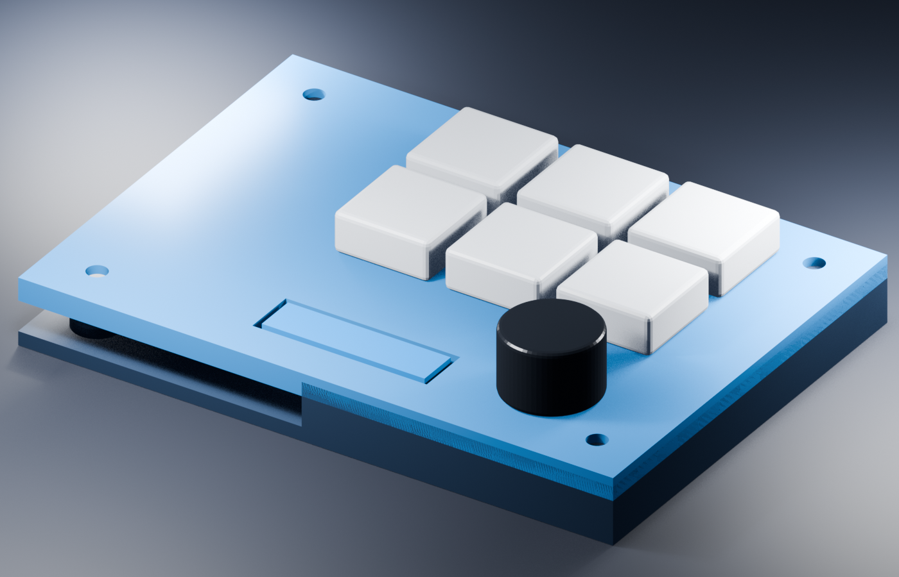
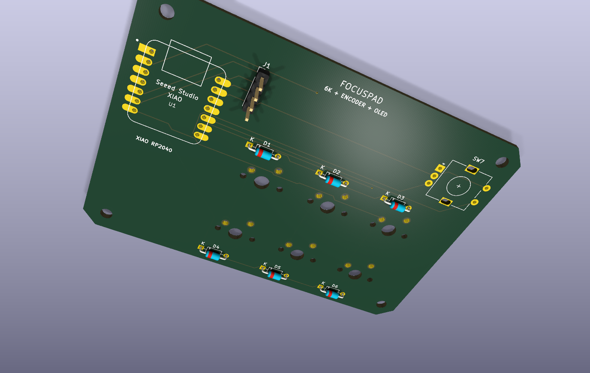
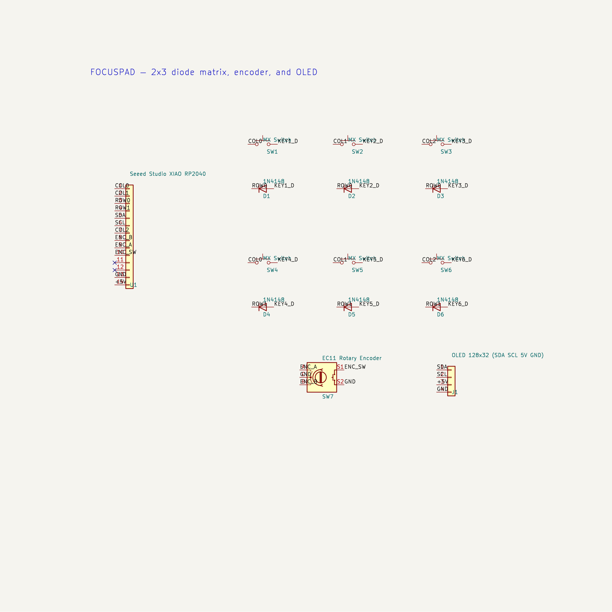

# Focuspad

Focuspad is a six-key productivity macropad built around the Seeed Studio XIAO
RP2040. It combines a 2×3 diode matrix, a pressable rotary encoder, and a
128×32 OLED in a compact 3D-printed enclosure.

I wanted a small desktop controller that keeps the shortcuts I use most within
one hand. The default KMK layout provides Copy, Paste, Undo, Reopen Closed Tab,
Find, and Enter. Turning the encoder changes volume; pressing it mutes.

## PCB

The two-layer PCB is 97×68 mm. Six 1N4148 diodes prevent ghosting in the 2×3
matrix. The OLED uses D4/D5 for I²C, and the encoder uses D7–D9. All footprints
are embedded in the KiCad board file.

KiCad 10 error-level DRC result: **0 violations and 0 unconnected pads**.
KiCad 10 error-level ERC result: **0 violations**. Reports are included in the
`PCB` directory. The design has not yet been manufactured or hardware-tested.

## Case

The case is a two-part PLA print with a 1.5 mm MX switch plate, four M3 heat-set
bosses, a USB-C opening, and 0.25 mm clearance around the PCB. The complete
assembly is in `CAD/Focuspad_Assembly.step`; printable STEP and STL parts are in
`production/`.

## Firmware

`Firmware/main.py` is original KMK firmware for CircuitPython. Installation and
library requirements are documented in `Firmware/README.md`. A production copy
is available at `production/main.py`.

## Repository structure

- `CAD/` — complete STEP assembly and parametric CadQuery source
- `PCB/` — KiCad project, schematic, PCB, DRC, and ERC reports
- `Firmware/` — KMK source and installation notes
- `production/` — Gerbers, printable case parts, and firmware
- `assets/` — README renders
- `BOM.csv` — bill of materials with links

## Bill of materials

| Qty | Part |
|---:|---|
| 1 | Seeed Studio XIAO RP2040 |
| 6 | MX-compatible switches |
| 6 | 1U keycaps |
| 6 | 1N4148 DO-35 diodes |
| 1 | EC11 rotary encoder with push switch |
| 1 | 0.91-inch 128×32 SSD1306 OLED |
| 4 | M3×16 socket-head screws |
| 4 | M3×5×4 heat-set inserts |
| 1 | Two-layer PCB |
| 1 | Two-part PLA case |

See `BOM.csv` for source links and notes.
